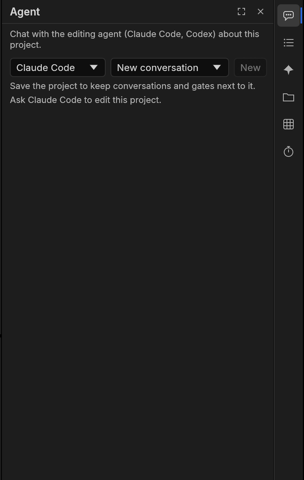

# The agent: editing with Claude Code or Codex

BashCutPro can be edited by an AI agent that uses the same commands you do. It follows the agent kit's editing
skills (rough cut by quote, captions, colour by measurement, loudness for each platform, review before export…) and
stops at each stage for your approval.

## In the app: the Agent section

You need **Claude Code** installed and signed in on this computer (the `claude` command). An app opened from the Finder
or the Dock does not see your terminal's `PATH`, so BashCutPro also looks in the usual install folders (`~/.local/bin`,
`~/.claude/local`, `~/.npm-global/bin`, `~/.bun/bin`, `~/.volta/bin`, `/opt/homebrew/bin`, `/usr/local/bin`; the same
for `codex`). If it is installed somewhere else, set the environment variable `BASHCUT_CLAUDE` to its path.

On macOS the first agent turn may ask *"BashCutPro" would like to access files in your Desktop folder* (or Documents,
Downloads) when the project lives there: click **Allow**. Until you answer, the agent stays on *running* and does
nothing.

1. **Save the project** first: conversations and the edit plan are kept next to it (in `<project>.fcproj.bashcut/`).
2. Open **Agent** on the rail (**Cmd+Alt+Shift+A**). Type what you want ("cut the ums, keep it under a minute, add
   Vietnamese captions") and press **Enter** (**Shift+Enter** for a new line).
3. The agent's replies stream in; the commands it runs are folded into one line each. Every edit it makes is a normal
   undo step. Your messages are bubbles on the right, the agent's replies sit under its name; point at either (or at a
   code block in a reply) to get a **Copy** button.
4. At each stage (brief, plan, rough cut, draft) it shows a **gate** card with what it did and the measurements behind
   it: **Approve** to go on, or write a note and **Ask for changes**.
5. **Stop** ends its turn within a few seconds, also in the middle of a long tool call; the transcript says
   "Stopped.", your project stays as it is, and your next message goes on in the same conversation. Messages you
   queued and it had not started go back into the message box. A tool the stop cut off shows **Stopped**.
   Each tool call is one row (icon, name, what it did, how long it took); a failed one says **Failed** with the
   reason under it, and a click on the row shows the details with a **Copy** link.
6. You can keep typing while the agent works: each message waits under the transcript as **You · queued 1**, **2**,
   … in the order the agent gets them. Click **✕** on one to remove it; the agent never answers it. One the agent
   has already picked up stays and is answered (use **Stop** for that).
7. When Claude Code needs something that is not allowed up front (a shell command, writing a file…), the transcript
   shows a card **Claude Code wants to use Bash** with the command or file: **Allow once** (the filled button) runs it this time;
   **Always for this project** runs it and adds a rule to `.claude/settings.local.json` in the project's folder (this
   project only, never your global settings; offered once the project is saved); **Deny** does not run it and tells
   the agent you said no, so it carries on another way. The agent waits for your answer; **Stop** denies a waiting
   card too. Batch agent steps never ask: anything that needs approval there is denied at once.

8. Type **/** to pick a skill or command: a list above the message box shows the ones your Claude Code has (the
   BashCutPro kit's as `/bcp:setup`, `/bcp:vlog-plan`, …), the closest matches first as you type (`/se` finds
   `/bcp:setup`). **↑/↓** pick, **Enter** or **Tab** puts it in the message box, **Esc** closes the list, or click
   one. The list loads with your first message in a conversation; before that it says *Start a message to load
   skills*. Codex has no such list.

**New** starts a new conversation; earlier ones are listed and can be opened again.

### Use Claude Code in a terminal

In the header's **menu** (the three-lines icon at the right), **Open in Terminal** opens a terminal window in the project's folder running the same agent
program the panel uses, resuming the panel's conversation (`claude --resume <id>`, or `codex resume <id>`): you get
the full Claude Code screen (its own permission prompts, `/` commands, history) on the same conversation. Come back
to the panel and press **Send** to keep going here. The terminal session talks to the open window through the agent
kit's tools; the panel's own tool connection is not passed along, except when the kit is missing (below): then
the terminal session gets the app's own tool connection, so it still reaches the open window. So that only one of
them writes the conversation, the panel first ends its own session (stopping a running turn); the transcript then
says "Continued in Terminal."

A status line under the buttons follows the terminal session (Claude Code only): "Terminal: working…", "waiting for your
permission" (until that tool runs or the turn ends), "done", "stopped with an error", "closed". It comes from Claude Code
hooks passed for that one session (`--settings <data folder>/agent/terminal-hooks.json`); your own Claude Code settings are
never changed. When you quit Claude Code in the terminal, the transcript says "Back in the panel." and **Send** continues here.
The first time in a folder, Claude Code asks whether you trust it: choose **Yes, I trust this folder**.

- **Sign in…** opens `claude` in a terminal: type `/login` and follow the steps in your browser. You sign in with
  Claude Code's own login (a Claude subscription or an API key); BashCutPro never reads or stores it.
- When a message fails because Claude Code is not signed in, the panel says **Claude Code is not signed in** under
  the header, with **Sign in…** next to it and Claude Code's own message below (you can select and copy it). A
  billing or organization problem with your Claude account shows as **account problem** instead. Sign in, then send
  your message again: the line goes away with the next message.
- When Claude Code is not installed, the "not found" line has an **Install** button. It opens a terminal running the
  official installer (`curl -fsSL https://claude.ai/install.sh | bash` on macOS and Linux,
  `irm https://claude.ai/install.ps1 | iex` in PowerShell on Windows). Nothing is installed until you press it.
- When BashCutPro finds no copy of the BashCutPro kit (the `bcp` plugin: the `/bcp:` recipes and skills) and Claude Code
  runs without it, the panel says **BashCutPro skills are not downloaded** after the first message, with a
  **Download kit…** button. It opens a terminal that clones the kit
  (`https://github.com/dongnguyenvie/bashcutpro-agent-kit`) into BashCutPro's data folder (`bashcut-kit`), or runs
  `git pull` when it is already there. Nothing is downloaded until you press it, and nothing is installed into
  Claude Code itself. When it finishes, your next message loads the kit. Without git the panel shows the zip address
  and the folder to unpack it into instead. A small note below gives the optional command for the skills in every
  Claude Code session: `claude plugin marketplace add dongnguyenvie/bashcutpro-agent-kit && claude plugin install
  bcp@bashcutpro-agent-kit`. The recipe buttons of an empty conversation need the kit too.
- An empty conversation asks "What should we edit?" and offers example chips (Remove the silences, Add captions to
  the main sequence, and kit recipes). A chip only fills the message box; nothing is sent until you press Send.
- The command palette has the same three actions: **Open Agent in Terminal**, **Sign In to Claude Code** and
  **Install Claude Code** (an agent driving BashCutPro can call them as `bashcut.agent.terminal`,
  `bashcut.agent.signIn` and `bashcut.agent.install`). Install still runs only when you choose it.
  **Download BashCutPro Kit** (`bashcut.agent.installKit`) does what **Download kit…** does; it refuses when the
  conversation already shows the kit.

The terminal is Terminal on macOS, Windows Terminal (else a PowerShell window) on Windows, and your desktop's
default terminal (else GNOME Terminal, Konsole or xterm) on Linux.

## Codex

Codex works as an outside agent (below) and in batch pipelines, whose agent steps can use `codex` instead of
Claude Code. The in-app Agent section offers both: pick Claude Code or Codex in its agent list. A missing one shows
"(not installed)" there, with a line under the header saying how to install it or which variable to set
(`BASHCUT_CLAUDE`, `BASHCUT_CODEX`).

## An agent in your terminal

Claude Code or Codex in a terminal can drive the open window too:

1. Install the agent kit (the first-run setup offers it), which registers BashCutPro's tools with the agent.
2. Open BashCutPro as usual. Its control channel starts by itself (on this computer only, 127.0.0.1) and the window
   tells agents where to find it. To keep agents out, untick **Allow AI agents to control BashCutPro** in the Agent
   section (applies at the next start), or set `BASHCUT_CONTROL=0`. `--control <port>` still picks a fixed port.
   The control channel is protected by a session code that BashCutPro makes each time it opens; agents started from
   BashCutPro get it automatically.
3. Ask the agent in the terminal; it connects to the open window by itself. With no window open, it works on the
   project file directly, and it refuses to open a project the window already has open.

Agents can only write inside the project's folder (and folders you allow), so a mistake cannot overwrite your other
files.
