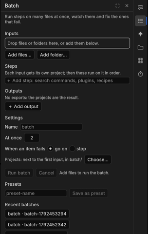

# Batch: many files at once

A batch runs the same steps on many files. **Every file becomes its own project**, the files are worked on side by
side in the background (the app stays free, and a batch even keeps going if you close the app), and each finished
step is saved, so a stopped batch picks up where it was.

## Build a batch

Open **Batch** on the rail (or **Run on many files…** from a plugin action or the agent).

1. **Inputs**: drop files or folders on the panel, or use **Add files…** / **Add folder…**. Video, audio and image
   files and existing projects (`.fcproj`) are all fine. A project you add is copied, never changed.
2. **Steps**: **＋ Add step** opens a search over commands, plugin actions and recipes (the same search as the
   palette). Steps run in order on each project.
3. **Outputs**: **＋ Add output** and pick an **Output profile** (TikTok, Reels, Shorts, YouTube, YouTube 4K, Facebook
   square; see [Output profiles](export.md)) or one of your **Export presets**. No output is fine too: then the
   projects are the result.
4. **Name** the batch, choose how many items run **At once**, and **When an item fails**: **go on** with the others
   or **stop**. **Projects** shows where the projects go (by default next to the first input, in `batch/`;
   **Choose…** to change it).
5. **Run batch**.

**Save as preset** keeps the whole setup for next time; **Presets** lists them.

## Ready-made presets

Five presets come with BashCutPro's plugins:

| Preset | What it does | Needs |
|---|---|---|
| `vietsub-folder` | speech to text, captions, translation to Vietnamese, covers burned-in subtitles, caption style; exports for TikTok and YouTube | the **translate-captions** plugin and an AI key (without a key the item waits for the agent) |
| `podcast-shorts` | finds 3 strong quotes and makes one vertical short each, with word captions | the agent (Claude Code) and the agent kit |
| `every-platform` | one version per screen shape (YouTube, TikTok, Reels, Shorts, Facebook square) with captions in each safe area | the agent and the kit |
| `captions-draft` | speech to text, captions in a clean word style, an `.srt` and a YouTube preview | – |
| `clean-audio` | voice polish and loudness to −16 LUFS, a clean `.wav` | – |

Until the app can install them itself, add them once from a terminal (the folder is in the `bashcutpro-plugins`
download): `bashcut-batch presets install bashcutpro-plugins/packs/batch`. They then show under **Presets**.

## Watching a batch

**Queue** shows one row per item with a progress bar per step; it learns how long each step takes, so the estimate
gets better. The summary line counts *done*, *failed*, *need attention* and *left*. Item states:

| State | Meaning |
|---|---|
| Waiting | not started yet (the batch also waits when memory or disk space is short, then goes on by itself) |
| Running | working on a step |
| Done | every step and export finished |
| Failed | a step failed; its message says why |
| **Needs attention** | a person (or the agent) has to look: the review found problems it could not fix (**needs fix**), a plugin handed the item over, or the batch stopped in the middle of a step |
| Not run / Stopped / Interrupted | the batch was stopped or cancelled before this item finished |

The batch keeps the computer awake while it runs and never starts more items than the memory allows.

## Fixing an item that needs a fix

When a batch has an agent step, the agent's work is reviewed (sound, picture, captions, cuts). Problems it could not
fix after two tries leave the item **needs attention**.

1. Click **Open to fix**: the item's project opens.
2. The problems are on the timeline as **Review markers**, each with a comment saying what is wrong and where (open
   **Window ▸ Markers** to see them as a list).
3. Fix them in the editor, then **save** the project.
4. Back in **Batch**, click **Retry** on that item (or **Retry failed** for all of them). Only the unfinished steps
   run again.

**Reveal** shows an item's files in Finder / Explorer; **Reveal folder** the whole batch.
