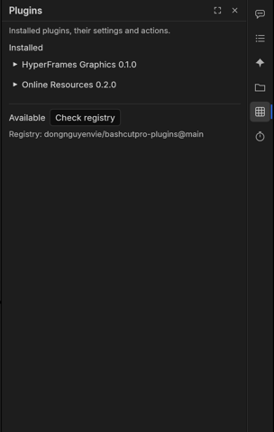
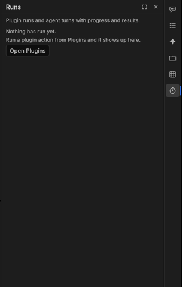

# The rail

The rail is the strip of icons on the right edge of the window. Each icon opens one section in the side panel; click
it again to close the panel. The same sections are in **Window ▸ BashCutPro**.

| Section | What it is for | Guide |
|---|---|---|
| **Agent** | Chat with an AI editor (Claude Code) about this project; it edits, you approve each stage | [The agent](agent.md) |
| **Batch** | Run the same steps on many files: each file becomes its own project and its own exports | [Batch](batch.md) |
| **Looks** | 26 colour looks, each with a one-line purpose; preview and apply to the selected clips | [Looks](looks.md) |
| **Library** | **Mine**: your saved pieces. **Online**: open music, sound effects, stock photos and video, icons, fonts | [Library](library.md) |
| **Plugins** | Install plugins (Vietnamese text to speech, caption translation, AI images, online resources…), set their keys, run their actions | below |
| **Runs** | Plugin runs, installs and registry checks, with progress, errors, results and log | below |

**Pop out.** The square button in a section's header moves it into its own window (handy on a second screen);
**Dock back** returns it to the side panel. **Cmd+Alt+Shift+A** jumps to the Agent section.

**Dots on the rail.** Hover an icon for its title, what it is for and its shortcut. A blue dot on **Runs** or
**Batch** means something is running there; a red dot on **Runs** means a run failed since you last looked. The dot
goes away when you open the section.

## The command palette

**Cmd+Shift+P** (or **Window ▸ BashCutPro ▸ Command Palette…**) finds anything by a few letters: commands, looks,
output profiles, plugin actions, templates and recipes. **↑ ↓** choose, **Enter** runs, **Esc** closes; **Tab** opens
the values of a command that takes some, with a line above saying which keys it accepts (`?` marks the optional ones).
See [Getting started](getting-started.md#4-find-anything-the-command-palette).

## Plugins

Plugins are small programs that run beside the app and bring their results in as ordinary media, captions or edits.

1. Open **Plugins**: the first time, it checks the registry by itself and lists what is available (**Refresh** checks
   again; hover "N plugins available" to see where the list comes from).
2. **Install** the ones you want (the button says **Installing…** until it is done). Most need Python 3.9 or newer on
   the computer.
3. Open a plugin's **Settings** to fill in its options. API keys are kept in your system's key store (Keychain on
   macOS, Secret Service on Linux), never in a file. Windows has no key store support yet: set the plugin's
   environment variable for the key (its README names it) before you start BashCutPro.
4. Each **action** has a small form; **Run** starts it. Actions that edit the open project need the app to have been
   started with its control channel (see [Troubleshooting](troubleshooting.md)).
5. The plugin's card then shows how the run goes: **Running 40 %**, **Done** or **Failed:** and the reason. **Open in
   Runs** shows its log; **✕** hides the line.

Removing a plugin also forgets its stored keys.

## Runs

Runs lists plugin runs, installs and registry checks, newest first. Each row shows progress and time (also while it
runs), the result's message, **Log** (what the plugin printed), **Copy log**, and **Cancel** while it runs. A run that
failed, crashed or timed out shows its full error in red (you can select and copy it) and **Retry**, which runs the
same action again with the same values. When a run wrote files, **Reveal** shows each one in its folder. While a batch
runs, one row says how far it is (**Batch: 3 of 10**) with **Open Batch**; the batch's own items are in Batch, and
agent turns stay in Agent. **Clear finished** tidies the list. When a plugin needs help (for example a translation without an API key) its run says **Needs the agent**:
**Send to agent** hands the job to the Agent section, which finishes it.

You never have to wait for a run: keep editing while it works. When a run ends while Runs is not open, a small note
appears at the bottom right for a few seconds: **✓ … finished** or **✕ … failed**. **Show** opens Runs on that run;
**✕** hides the note. A message at the top of Plugins or Runs also has **✕**; it comes back only with a new message.
