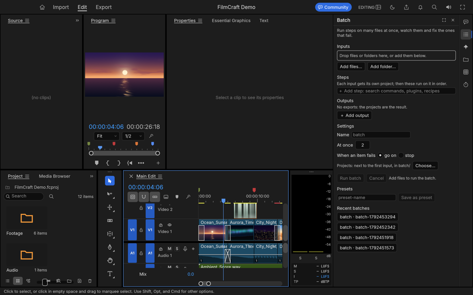
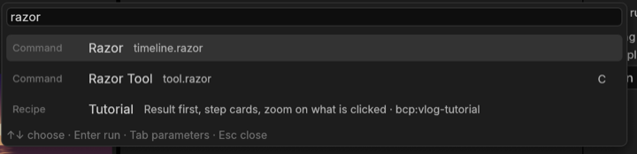

# Bắt đầu

Hướng dẫn này ghi tên nút theo giao diện tiếng Việt, kèm tên tiếng Anh trong ngoặc. **Cmd** trên Mac là **Ctrl** trên
Windows và Linux. Bản gốc tiếng Anh: [Getting started](../en/getting-started.md).

## 1. Cài đặt

Cài BashCutPro từ gói cài cho hệ điều hành của bạn (macOS `.app`, bộ cài hoặc bản zip di động cho Windows, gói Linux).
Mỗi gói kèm dòng lệnh `bashcutpro-cli` (tên ngắn `bcpro`; đây chính là bộ máy mà ứng dụng dùng) và ba chương trình
phụ: `bashcut-doctor` (kiểm tra máy), `bashcut-batch` (chạy hàng loạt) và `bashcut-mcp` (cho trợ lý AI kết nối vào cửa
sổ đang mở), cùng một tập lệnh thiết lập lần đầu.
Khi BashCutPro đang mở, `bashcutpro-cli exec …` (và `run`, `inspect`, `mcp`, …) làm việc trên cửa sổ đang mở; thêm
`--project`, hoặc đặt `BASHCUT_BRIDGE=off`, để dùng bộ máy mà không cần cửa sổ.

### Chưa có gói cài? Tự dựng từ mã nguồn

Hiện chưa có gói cài phát hành, nên tạm thời bạn tự dựng BashCutPro. Mất khoảng mười phút trên một máy Mac đời mới và
cần chừng 10 GB đĩa trống. Các bước dưới đây dành cho macOS; trên Linux và Windows lệnh `cargo` giống hệt.

1. Cài bộ công cụ dòng lệnh của Apple nếu `git --version` chưa chạy được: `xcode-select --install`.
2. Cài Rust (phiên bản 1.95 trở lên):
   `curl --proto '=https' --tlsv1.2 -sSf https://sh.rustup.rs | sh`, rồi mở cửa sổ terminal mới để có lệnh `cargo`
   (kiểm tra bằng `rustc --version`).
3. Lấy mã nguồn. Các kho hiện là riêng tư, nên tài khoản GitHub của bạn cần được cấp quyền:
   `gh repo clone dongnguyenvie/BashCutPro && cd BashCutPro`.
4. Dựng ứng dụng và các công cụ dòng lệnh, kèm chuyển giọng nói thành chữ:

   ```sh
   cargo build -p filmcraft -p bashcutpro-cli -p bashcut-doctor -p bashcut-batch-cli -p bashcut-mcp \
     --features filmcraft/whisper,bashcutpro-cli/whisper
   ```

5. Cho terminal này tìm thấy các công cụ: `export PATH="$PWD/target/debug:$PATH"` (thêm dòng đó, với đường dẫn đầy đủ,
   vào `~/.zshrc` để giữ lại). Khi đó `bashcutpro-cli --version` (hoặc `bcpro --version`) trả lời
   `bashcutpro-cli` kèm số phiên bản.

Với bản tự dựng, bước thiết lập lần đầu bên dưới là `bash bashcut/packaging/share/bashcut-setup.sh`, và bạn mở ứng dụng
bằng `target/debug/filmcraft --control 9876`.

Nếu bạn sửa mã nguồn, hãy dùng `cargo xtask dev --features whisper -- --control 9876`: lệnh này dựng lại ứng dụng cùng
mọi công cụ dòng lệnh của nó rồi mở ứng dụng. `cargo run -p filmcraft` chỉ dựng lại ứng dụng, nên trợ lý AI, plugin,
Batch và doctor sẽ vẫn dùng bộ máy cũ.

Muốn có ứng dụng macOS và tệp DMG thì chạy `bash packaging/macos/package.sh --arch aarch64` (máy Mac chip Intel dùng
`x86_64`). Lệnh này dựng bản phát hành đầy đủ nên lâu hơn. Kết quả nằm trong `dist/release/`. Bản này chỉ được ký cho máy
này: nó mở được ở đây, còn máy Mac khác sẽ từ chối cho đến khi được ký và công chứng (notarise) bằng Developer ID.

## 2. Thiết lập lần đầu (tùy chọn, một lần)

Tập lệnh chuẩn bị các tệp riêng của BashCutPro. Bước nào cũng bỏ qua được.

| Hệ điều hành | Tập lệnh nằm ở | Chạy |
|---|---|---|
| macOS | trong ứng dụng: `BashCutPro.app/Contents/Resources/bashcut/` | `bash bashcut-setup.sh` |
| Windows | thư mục cài đặt | `powershell -File bashcut-setup.ps1` |
| Linux | `/usr/share/bashcutpro/` | `bash bashcut-setup.sh` |

Nó tạo thư mục cho hồ sơ xuất, mẫu dự án và màu phim, ghi bộ màu phim thành các tệp LUT `.cube`, biến các hồ sơ xuất
thành thiết lập xuất (tên **BashCut TikTok**, **BashCut YouTube**…), đề nghị cài bộ kỹ năng trợ lý (agent kit) khi máy
có Claude Code hoặc Codex, và cuối cùng chạy kiểm tra máy (`bashcut-doctor`). Thêm `--yes` để đồng ý mọi bước, hoặc
`--skip-looks`, `--skip-profiles`, `--skip-kit`, `--skip-doctor` để bỏ một bước.

**Mô hình giọng nói.** Phụ đề, các thiết lập sẵn của Hàng loạt và bước dựng thô của trợ lý đều bắt đầu bằng việc chuyển
giọng nói thành chữ, nên máy cần có một mô hình giọng nói. Tải một lần: `bashcutpro-cli exec transcript.downloadModel` tải
**whisper-base** (khoảng 290 MB), mô hình mặc định. Sau đó `bashcut-doctor` báo `[ok] speech`. Chưa tải thì việc chép
lời dừng với thông báo *the speech model `whisper-base` is not downloaded*. Mô hình nhỏ hơn **whisper-tiny** (khoảng
150 MB: `bashcutpro-cli exec transcript.downloadModel model=whisper-tiny`) nhanh hơn nhưng kém chính xác hơn. Muốn dùng nó
thì chọn trong **Cài đặt ▸ Media Analysis & Transcription ▸ Speech model**.

## 3. Mở ứng dụng

Bạn thấy trình dựng của FilmCraft với một phần thêm: **thanh bên** hẹp ở mép phải. Mỗi biểu tượng mở một mục trong
bảng bên: **Trợ lý** (Agent), **Hàng loạt** (Batch), **Màu phim** (Looks), **Thư viện** (Library), **Plugin**
(Plugins), **Tác vụ** (Runs) ([Thanh bên](rail.md)). Bấm lại biểu tượng đó để đóng. Kéo mép trái của bảng để nới rộng
(240–720 px). Thanh bên có ở mọi trang (Nhập, Chỉnh sửa, Xuất); Màu phim và Thư viện áp dụng lên timeline nên ngoài trang Chỉnh sửa sẽ có nút **Mở trình chỉnh sửa**. **Window ▸ BashCutPro ▸ Hiện thanh bên** (Show Rail) để tắt / bật.



## 4. Tìm mọi thứ: bảng lệnh

Nhấn **Cmd+Shift+P**. Gõ vài chữ của thứ bạn cần: một lệnh ("razor", "export"), một màu phim ("teal"), một hồ sơ xuất
("tiktok"), một thao tác plugin, một mẫu dự án hay một công thức ("travel vlog"). **↑ ↓** để chọn, **Enter** để chạy,
**Esc** để đóng. Thứ bạn hay dùng sẽ lên đầu. Lệnh nào cần giá trị thì **Tab** (hoặc Enter trên lệnh đó) mở một ô sửa
nhỏ; đổi giá trị rồi nhấn **Cmd+Enter**. Mọi thứ bảng lệnh chạy đều hoàn tác được bằng **Cmd+Z** như mọi thao tác dựng.



(**Cmd+K** vẫn là *Add Edit* của FilmCraft nên bảng lệnh có phím riêng. Đổi phím tắt bất kỳ trong
**Edit ▸ Keyboard Shortcuts**.)

## 5. Tiếng Việt

Các bảng riêng của BashCutPro hiển thị được bằng tiếng Việt: chọn **Window ▸ BashCutPro ▸ Language ▸ Tiếng Việt**
(khi đã chọn tiếng Việt, menu này ghi là **Ngôn ngữ**). Các bảng đổi ngay và giữ nguyên ở lần mở ứng dụng sau. **English**
luôn hiển thị tiếng Anh dù ứng dụng đang dùng ngôn ngữ nào; **Theo ứng dụng** (khi menu còn tiếng Anh: **Follow App**; mặc định) dùng ngôn ngữ giao diện của ứng
dụng. Dấu tích cho biết lựa chọn hiện tại.

Tiếp theo: [Thanh bên](rail.md).
