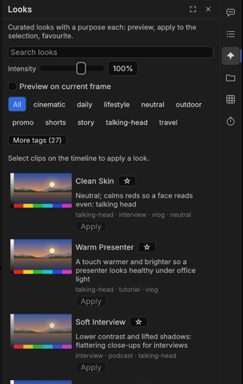

# Màu phim: chỉnh màu một cú bấm

**Màu phim** (Looks) trên thanh bên có 26 màu. Mỗi màu ghi một dòng mục đích ("Neutral; calms reds so a face reads
even: talking head" – trung tính, dịu sắc đỏ để gương mặt đều màu: video nói trước máy quay), có nhãn thể loại và một
núm **Cường độ** (Intensity).

1. Chọn các clip trên timeline.
2. Mở **Màu phim**. Lọc bằng ô tìm kiếm hoặc một nhãn (*talking-head*, *travel*, *food*, *product-ad*, *tutorial*,
   *news*, *daily*, *cinematic*, *shorts*, *mono*, *fix*…).
3. Ảnh nhỏ cho thấy từng màu trên một cảnh mẫu. Đánh dấu **Xem trước trên khung hình hiện tại** để xem trên chính khung
   hình của bạn tại đầu phát (**Làm mới** sau khi dời đầu phát).
4. Chỉnh **Cường độ** (100 % = màu đúng như thiết kế; thấp hơn thì nhẹ hơn). Mỗi màu có giới hạn an toàn nên không bao giờ
   đẩy quá mức hợp với da người và vùng sáng.
5. **Áp dụng** (Apply). Thẻ màu ghi **Đang dùng** (Applied).

Áp một màu khác sẽ **thay** màu trước (màu không chồng lên nhau). **Gỡ màu** (Remove look) bỏ màu khỏi các clip đang
chọn. **Cmd+Z** hoàn tác cả hai. ☆ đánh dấu yêu thích: màu yêu thích luôn ở trên cùng.

Màu phim là một hiệu ứng **Lumetri Color** bình thường trên clip, nên bạn tinh chỉnh tiếp trong **Effect Controls** như
mọi lần chỉnh màu. Màu phim cũng có trong bảng lệnh (gõ tên màu).

**Màu sửa lỗi** (*Fix Orange Indoor Light* – sửa đèn vàng trong nhà, *Fix Grey Day* – sửa trời xám) sửa lỗi hay gặp chứ
không thêm phong cách; dùng chúng trước, rồi thêm một màu phong cách nếu muốn.

Mọi màu đều được kiểm tra: trên các màu mẫu, ở cường độ thấp nhất, bình thường và cao nhất, màu không được làm cháy vùng
sáng, bệt vùng tối hay lệch màu da.
