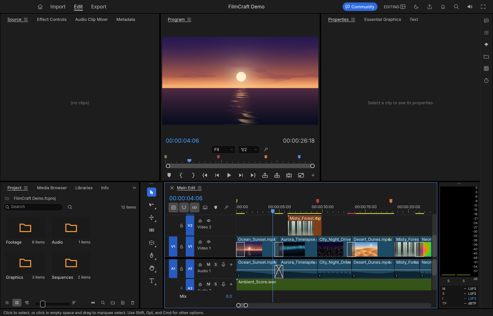
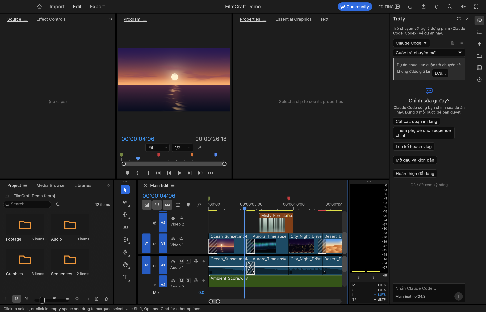
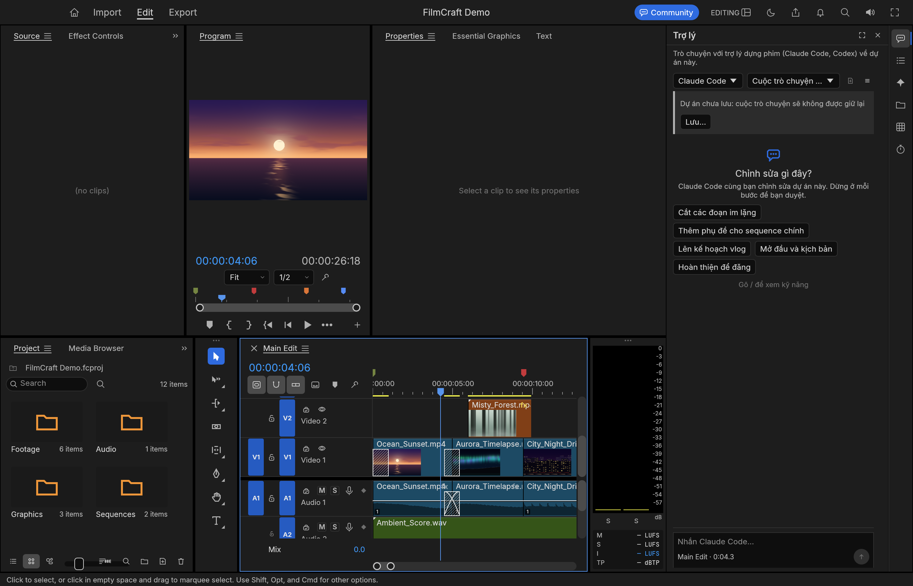
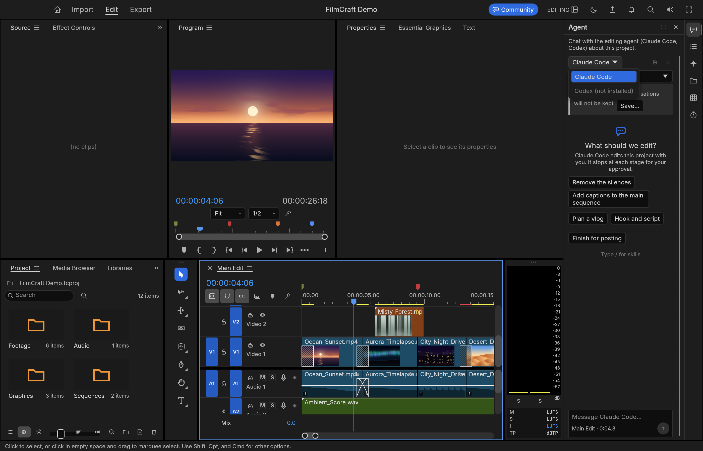
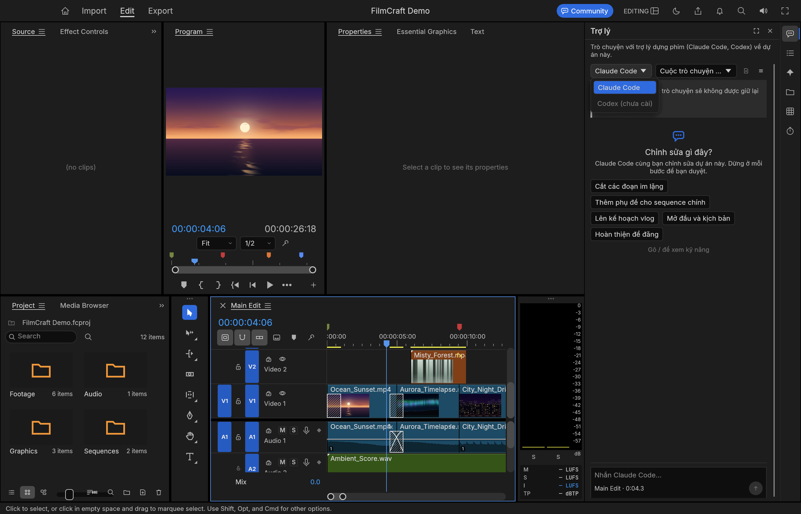

# Agent Panel Contact Sheet — 2026-10-25b
Build `27ab8542e` · BashCutPro 0.12.1 · macOS aarch64 · 2026-10-25

---

## Full window (EN)

---

## Agent panel: empty state — EN

### 340 px

### 240 px (narrow)

---

## Agent panel: empty state — VI

### 240 px (narrow)

### 340 px

---

## Terminal live lock (fake hook events injected via bashcut.agent.terminalEvent)
*Note: the terminal status row only renders when a live session is active (resume argv set). These shots show the panel state after event injection; the status line is not visible without a real agent session.*

### PreToolUse (Working)

### Notification (Waiting)

### Stop (Done)

---

## Model picker open — EN

### 340 px

### 240 px (narrow)

---

## Model picker open — VI, 340 px

---

## Agent panel: empty state — VI, 240 px (second capture)

---

## Rail with Agent panel closed (EN)

