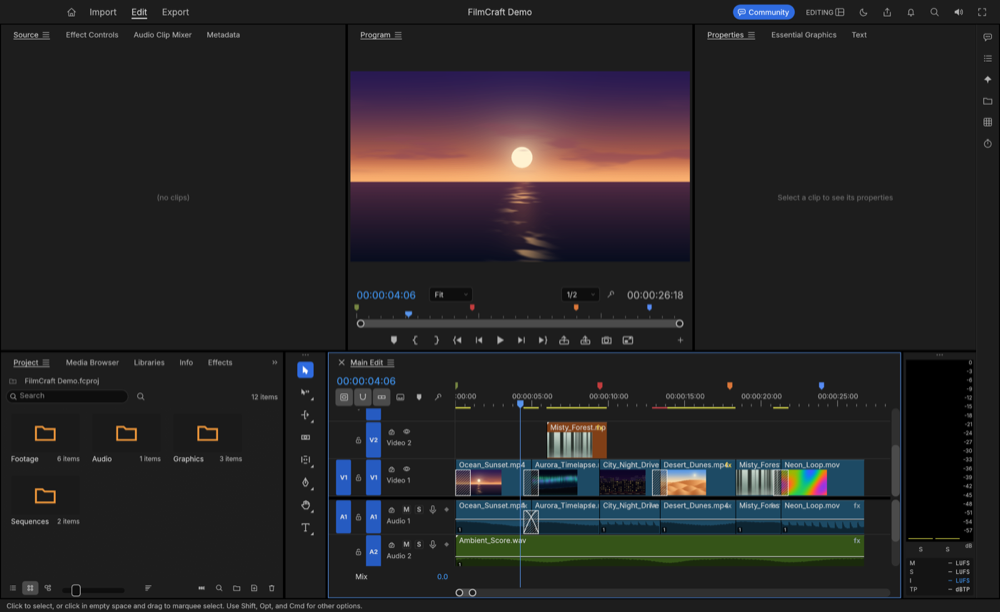
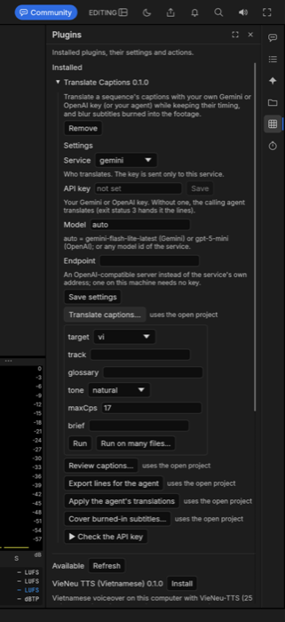
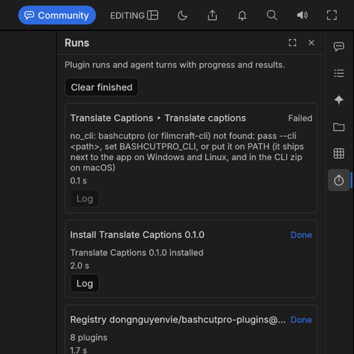
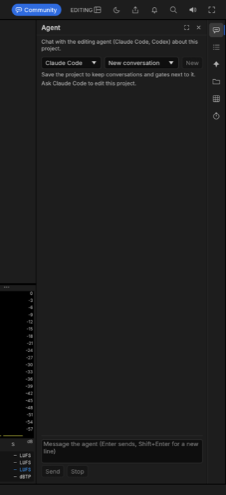
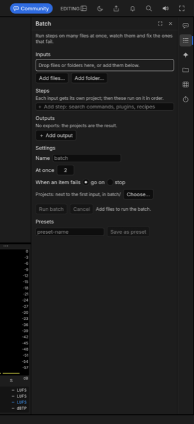

# UX audit of the BashCutPro extension (rail + side panel), 2026-10

Ticket UX0. Scope: everything BashCutPro adds to FilmCraft's window: the rail, the side panel and pop-out windows,
and the Agent, Batch, Looks, Library, Plugins and Runs sections (`crates/ui-egui/src/bashcut_ui/`), plus how plugin
forms are built from `bashcut-plugin.json` manifests (`bashcutpro-plugins`). The command palette is only covered where
the sections lean on it. The audit made no code changes. Its output is the ticket list in §9.

**How it was done.** BashCutPro `main` at `55d402db`, `bashcutpro-plugins` `389f9b1`. All of `bashcut_ui/` was read, along with `in-app-ui.md`, `plugin-host.md`, `status.md` and the guide
(`guide/en/`). The app was built and run on macOS (`cargo build -p filmcraft --release`, 2.5 min warm) with a fresh
`--data-dir` to simulate a first launch, `--demo` and `--control 9876`, then driven over the control channel
(`bashcut.ui.section`, `ui.click`, `ui.screenshot`). Real journeys run: first launch, every section's empty state,
Check registry, Install Translate Captions, open its settings and its *Translate captions…* form, Run, and the
failure in Runs. Not run live (from code only): the Agent turn (Claude Code not exercised), a batch run, Library
search, and "no `--control`" (the window cannot be driven without it). Screenshots are in [`ux-audit/`](ux-audit/).

Severity: **P1** = the user is blocked or misled with no way out in the UI; **P2** = real friction or wrong
feedback on a main journey; **P3** = polish or consistency.

## 1. Cross-cutting

| # | Sev | Finding | Evidence | Fix proposal |
|---|---|---|---|---|
| X1 | P1 | **Prerequisites are only discovered by failing.** Missing `--control`, Python, `claude`, or `filmcraft-cli` beside the app all show up only after the user presses Run or Send. The message is a raw process error (`cannot start \`python3\`: No such file or directory (os error 2)`, `no_cli: bashcutpro (or filmcraft-cli) not found: pass --cli <path>, set BASHCUTPRO_CLI…`). Nothing in the UI tells the user ahead of time that the app was started without its control channel. A Finder-launched `.app` can never have it, and the only fix the guide gives is a terminal command. | `bashcut-plugin-host/src/manifest.rs:310`, `runner.rs:137`, `bashcut-agent/src/process.rs:121,211`; seen live: [runs-failed.png](ux-audit/runs-failed.png) | A small **setup line** at the top of Plugins and Agent: "Control channel: off (project actions and the agent need it): how to turn it on", "Python 3: not found", "Claude Code: not found". Use the same checks as `bashcut-doctor`, run once and cached. Map the known spawn and `no_cli` errors to a sentence plus a link to *Troubleshooting*. Project actions are disabled with a tooltip instead of failing. Longer term, the app should be able to start the control channel itself (§8). |
| X2 | P2 | **Error colour is hard-coded** `Color32::from_rgb(0xe0,0x6c,0x5f)` in 11 places, not the theme's `Tokens::danger`, so the light theme and any future theme change miss it. | `agent_panel.rs:94,245`, `batch_panel.rs:80,366,395,410`, `library_panel.rs:355,467`, `plugins_panel.rs:88`, `looks_panel.rs:209`, `runs_panel.rs:48` | Use `app.tokens.danger` everywhere. A "waiting" or paused state is not an error: use `text_dim`. |
| X3 | P2 | **Status and errors appear at the top of a scrolled panel**, far from the button that caused them. They stay until the next success and cannot be dismissed. After *Run*, Plugins shows "Started run 3" at the top and then **never shows that the run failed**. | `plugins_panel.rs:87-91,196,339`; live: Run on Translate captions failed in Runs while Plugins still said "Started run 3" | Put the outcome next to its card or button (per-card status line), and add a short-lived toast for finished runs (the overlay `Area` already exists, `in-app-ui.md` §3). Make status lines dismissable. |
| X4 | P2 | **Choosing Vietnamese means typing JSON** into the palette (`{"language": "vi"}`). | `guide/en/getting-started.md` §5; `mod.rs:230,251,267` | Add **Window ▸ BashCutPro ▸ Language ▸ Follow app / English / Tiếng Việt** (radio items from `menu_items`, `mod.rs:283`) and update the guide. |
| X5 | P3 | One Vietnamese string is missing (`Needs fix`, batch status). Plugin manifest text (titles, help, summaries) is English only. | `batch_panel.rs:59`, `strings/vi.tsv` | Add the row, plus a unit test that every `status_label` / `state_label` string is in `vi.tsv`. Manifest i18n (`title_vi`…) is a separate design question (§8). |
| X6 | P3 | Text fields have fixed widths (140 / 160 px) whatever the panel width, so a 720 px panel still has 140 px key fields. | `plugins_panel.rs:225,390`, `batch_panel.rs:301,458` | `desired_width(ui.available_width() - label)` or an `egui::Grid` with a stretching second column (see P5). |

## 2. Rail and side panel (first launch)

The rail is six monochrome 28 px icons with no labels. Tooltips give the title only. The open section gets an accent
bar. The side panel opens at 340 px and can be resized and popped out.

| # | Sev | Finding | Evidence | Fix proposal |
|---|---|---|---|---|
| R1 | P2 | **No activity on the rail.** A plugin run, install or batch that ends while another section (or none) is open gives no sign: no badge, dot or count. Failed runs are found only by opening Runs. | `rail.rs:17-55` | A dot on the **Runs** icon (accent while something runs, danger after a failure the user has not seen) and on **Batch** while a batch runs. "Seen" is cleared when the section opens (in `State`, not saved). |
| R2 | P2 | **The panel silently fails to open in a narrow window.** When the window is narrower than 320 + 240 px, clicking an icon marks it open but draws nothing. | `side_panel.rs:27-31` | In that case, pop the section out (the floating window already exists), or show a one-line toast "Window too narrow: section opened in its own window". |
| R3 | P3 | Icons are generic: Batch = list, Plugins = grid, Library = folder (the same metaphor as FilmCraft's Project bins), Runs = stopwatch. Tooltips are only the title, with no blurb or shortcut. | `mod.rs:50-81`, `rail.rs:47` | Tooltip = **title + blurb + shortcut** (Agent: Cmd+Alt+Shift+A). Changing icons needs new drawings in `bashcut_ui` (no upstream `icons.rs` edit), so keep that out of this round. |
| R4 | P3 | No keyboard way to close the panel or move between sections. Esc does nothing and only Agent has a shortcut. | `mod.rs`, `side_panel.rs` | Esc closes the panel when focus is inside it. `bashcut.ui.show.<section>` are already rebindable, so mention that in the guide. |
| R5 | P3 | Each section repeats its blurb under the title on every visit, which takes one or two lines of a narrow panel. | `side_panel.rs:86` | Show the blurb only in the empty state, or as the header's tooltip. |

## 3. Plugins

Journey: **Check registry → Install → Settings (keys) → action form → Run.** The registry check and install work
smoothly, in about 2 s each live.

| # | Sev | Finding | Evidence | Fix proposal |
|---|---|---|---|---|
| P1 | P1 | **Form labels are raw param ids.** All **200 of 200** params in the 8 published plugins have no `title`, so the form shows `target`, `track`, `glossary`, `maxCps`, `brief`, `out_dir`… | live screenshot; manifests in `bashcutpro-plugins/plugins/*/bashcut-plugin.json`; label fallback `plugins_panel.rs:302` | (a) App: when `title` is missing, show a humanised id ("maxCps" → "Max CPS", "out_dir" → "Out dir"). (b) Plugins repo: add a `title` to every param. Both are tickets (§9). |
| P2 | P2 | **Forms ignore what the manifest already says.** 108 required params are not marked (only 92 are `optional`). `integer` / `number` (47 params) are plain text with `minimum` / `maximum` ignored, so a bad value fails only after the run. The 49 `path` params have no **Browse…**. | `plugins_panel.rs:300-309,357-363,374-393`; `bashcut-plugin-host/src/manifest.rs:140-152` | Mark required fields (`*`) and disable Run with the reason until they are filled. Use `DragValue` with the range for numbers. Add a **Browse…** button for `path` (`FileDialog`, as Batch does at `batch_panel.rs:145`). Send numbers as JSON numbers. |
| P3 | P2 | **Feedback after Run.** Run is meant to switch to Runs (`plugins.rs:96`), but clicking the form's Run left the panel on Plugins (`bashcut.ui.state` → `open: "plugins"`). The failure was then visible only in Runs. | live: `ui.click bashcut.plugins.bashcut.translate-captions.translate.run`, then `bashcut.ui.state` | Find out why the `State::update` switch is lost when the click comes from inside `draw` (`mod.rs:128-140`). Then either switch reliably or, better, stay on the form and show the run's live status in the card (X3) with an "Open in Runs" link. |
| P4 | P2 | **Before the first check, the registry is jargon** ("Registry: dongnguyenvie/bashcutpro-plugins@main") and nothing is listed until the user finds **Check registry**. The Install button stays enabled while that plugin installs. | `plugins_panel.rs:105-127,139` | Check the registry on first open when there is no cached copy (one run, no repeat). Show "8 plugins available" instead of the location (location in a tooltip). Show **Installing…** (disabled) while `Host` reports an install for that id (`host.rs:311`). |
| P5 | P3 | **Settings layout.** Labels and fields are not aligned (no grid). Secrets have their own **Save** per field while the other settings share **Save settings**. **Remove** is the first button on the card, above Settings. Help text exposes protocol details ("exit status 3 hands it the lines"). | screenshot; `plugins_panel.rs:178,203-264`; help text in `translate-captions/bashcut-plugin.json` | `egui::Grid` for settings. One **Save** for the whole form, with secrets saved in the same click. Move **Remove** to the bottom (or a ⋯ menu) and ask for confirmation. Rewrite manifest help in user words (plugins repo, together with P1b). |
| P6 | P3 | Actions without params get a ▶ prefix and actions with params a trailing "…" from the manifest, so the two look different. "uses the open project" sits on every project action (5 of 6 in Translate Captions). | `plugins_panel.rs:278,288-290` | Same button style for every action. One line under the actions ("Actions marked ● edit the open project") or an icon, instead of repeating the text. |

## 4. Runs

| # | Sev | Finding | Evidence | Fix proposal |
|---|---|---|---|---|
| U1 | P2 | **Failure does not look like failure.** Failed, Crashed and Timed out are drawn in `text_dim`, the same grey as Cancelled, while Done is the accent colour. | `runs_panel.rs:67`; screenshot | Use danger for Failed / Crashed / Timed out, `text_dim` for Cancelled, the accent for Done, and a distinct colour for Needs the agent. |
| U2 | P2 | **A failed run has nothing to look at.** The **Log** button is disabled when the plugin printed nothing (the usual case for a spawn or `no_cli` failure). The message is the raw `code: text`, and there is no **Retry**. | `runs_panel.rs:81-83,93`; live run 3 | Always show the full error (`Outcome::error`, `PluginResult::error.code/message`) in the expanded row. Translate the known codes (X1). Add **Retry** (same plugin, action and params) and **Copy** for the log. |
| U3 | P2 | **Where did the result go?** A finished run shows only its message: there is no **Reveal** for files it wrote and no way to see what it changed on the timeline. | `runs_panel.rs:81-87`; `bashcut-plugin-host/src/runner.rs:65-70` (`data` is unread) | Show **Reveal** for path-like values in `result.data` (`path`, `paths`, `files`, `outputs`), and **Go to** for `markers` / `clips` / `time` that a plugin returns. Document these keys in `plugin-host.md` §Results. |
| U4 | P2 | **Runs claims more than it lists.** The blurb and the guide say "plugin runs and agent turns", and `in-app-ui.md` says batches too, but only plugin-host jobs are listed. | `mod.rs:80`; `runs_panel.rs:41`; `guide/en/rail.md` | Smallest fix: make the blurb and guide say what is there ("Plugin runs, installs and registry checks"), and add a single "Batch: 3 of 10 running · Open Batch" row while a batch runs. Agent turns stay in the Agent section. |
| U5 | P3 | Elapsed time shows only after a run ends. A long run shows a bar but no time. The log is not selectable. | `runs_panel.rs:84-87,108` | Elapsed time while running, and a selectable monospace log. |

## 5. Agent

| # | Sev | Finding | Evidence | Fix proposal |
|---|---|---|---|---|
| A1 | P1 | **No readiness check.** The picker lists Claude Code and Codex whether or not they are installed. Without `--control` or with no `claude` on PATH, the first **Send** fails with a process error in red at the top. The empty state only says "Ask Claude Code to edit this project." | `agent.rs:24`, `agent_panel.rs:93-109`; `bashcut-agent/src/process.rs:121,211` | Setup line (X1) under the header: agent found / not found (with install hint and `BASHCUT_CLAUDE`), control channel on / off, project saved / unsaved. Grey out agents that are not found in the picker ("Codex: not installed"). Disable **Send** with the reason. |
| A2 | P2 | **Replies are plain text.** Agents answer in Markdown, so `**bold**`, lists, headings and code fences show raw. Tool rows show raw JSON input. | `agent_panel.rs:220-224,271` | A small Markdown renderer (paragraphs, `#` headings, bullets, `**bold**`, inline code, fenced code) in its own file, used for `Item::Assistant`. Tool rows: one-line summary (`timeline.razor at 00:01:02`) with the JSON behind the fold. |
| A3 | P2 | **Empty state does not teach.** First open is a big blank area with one dim line. Users don't know what the agent can do, that it stops at gates, or that the project should be saved first. | screenshot | Three example prompts as buttons that fill the input (from the kit recipes the palette already lists, `palette.rs`), plus one line on gates. |
| A4 | P3 | **Ask for changes** is disabled until a note is typed, and nothing says why except the placeholder. **Approve** silently sends a typed note. | `agent_panel.rs:191-204` | Tooltip on the disabled button: "Write what to change first". Approve's label says "Approve with note" when a note is typed. |
| A5 | P3 | On an unsaved project the conversation is lost on restart, but the warning is a dim line that looks like the other hints. | `agent_panel.rs:97-99` | Same setup-line style as A1, with a **Save project…** button (`file.save`). |

## 6. Batch

| # | Sev | Finding | Evidence | Fix proposal |
|---|---|---|---|---|
| B1 | P2 | **Starting points are at the bottom.** Presets (and Recent batches) come after Inputs, Steps, Outputs, Settings, Run and the queue. Templates, "the usual starting point" in the design, have no entry in the section. A new user builds from scratch. | `batch_panel.rs:88-117,443-467`; `in-app-ui.md` §1a | A **Start from: [preset ▾]** row at the top, under the blurb (load preset; recent jobs in the same menu). Keep *Save as preset* where it is. |
| B2 | P2 | **Step parameters are raw JSON** in a code editor. A plugin step has a full manifest, but it is edited as JSON. | `batch_panel.rs:212-226` | For plugin steps, reuse the Plugins form fields (after P2 makes `field` reusable). For engine commands, show the command's signature line above the JSON, as the palette does (`palette.rs`), and validate on Apply. |
| B3 | P3 | "Waiting: low disk" is drawn in error red, though nothing failed. **Recent batches** rows show the job file name. The inputs list has no count or **Clear all**, and the ✕ sits before the name. | `batch_panel.rs:110-116,130-137,366` | Dim or warning colour for waiting. Recent rows show "name · date · 8 done / 1 failed". "12 files · Clear all" over the list. |
| B4 | P3 | Outputs are file-name buttons (thumbnails are already listed as not yet done in `in-app-ui.md` §6a). The projects folder cannot be reset to its default once chosen. | `batch_panel.rs:330-342,413-417` | A ✕ next to a chosen folder resets it. Thumbnails stay on the existing backlog. |

## 7. Looks and Library

These two are the most finished sections. Each has a clear empty state (Library: "Install the Online Resources plugin
to use this tab" plus **Open Plugins**; Looks: "Select clips on the timeline to apply a look."), a selection count
and licence lines.

| # | Sev | Finding | Evidence | Fix proposal |
|---|---|---|---|---|
| L1 | P3 | Library's **Open Plugins** goes to the plugin list, where the user has to find **Check registry** and then the right plugin. | `library_panel.rs:360-365`; [library.png](ux-audit/library.png) | **Install Online Resources** right there (`bashcut.plugins.install`, after a registry check if needed), with a spinner. |
| L2 | P3 | Library ▸ Preview opens the browser (known, `in-app-ui.md` §4). Looks: a failed preview reuses the hard-coded red (X2). | `library_panel.rs:476`, `looks_panel.rs:209` | X2. In-app preview stays on the backlog. |

## 8. Out of scope here: issues for new tickets

- **The app cannot turn its control channel on by itself.** Every fix above only explains `--control`. A Finder or
  Dock launch on macOS still cannot run project actions or the agent until the user restarts from a terminal.
  Options: start the channel on first need (on a random free port, written to `automation.json`, which `bashcut-mcp`
  already reads), or a Settings switch. This touches upstream's control server start in `apps/filmcraft` and
  `crates/ui-egui/src/lib.rs`, which **the v0.10 merge changes** (`lib.rs`, +103 lines). It is a design decision for
  `decisions.md` first, with a security note: the channel has no token (`connect.rs:8-9`).
- **Run → Runs switch lost** (P3): looks like a state bug in `layout`. Fixed as part of UX5 below if it is quick,
  otherwise its own `fix/bc-…` ticket.
- **Source builds miss `filmcraft-cli` beside the app.** `cargo build -p filmcraft` alone gives a window whose plugin
  runs all fail with `no_cli` (seen live). The guide's build line builds it, but `cargo run -p filmcraft` (CLAUDE.md)
  does not. `bashcut-doctor` or the setup line (UX4) should name it.
- **Manifest i18n** (Vietnamese titles and help for plugins): needs a manifest field (`bashcut-plugin/1` change). This
  is a design question, not a UX ticket.
- `guide/en/agent.md` says "the in-app Agent section uses Claude Code for now", but `in-app-ui.md` §6 and
  `agent.rs:24` ship a Codex adapter in the picker. One of them is wrong.

## 9. Ticket list

Each ticket is about 30–60 min and has one concern. All `Owns` paths are BashCutPro files unless marked. Every
ticket ships with a test in `crates/ui-egui/tests/bashcut_ui.rs` or a unit test in the file it touches, `cargo fmt`,
`cargo clippy -p filmcraft-ui-egui`, `cargo test -p filmcraft-ui-egui --test bashcut_ui`, and a `ui.screenshot` look.

**Upstream merge:** the v0.10 merge (`105c09bd..upstream/main`, 41 commits, 56 files) changes no file under
`crates/ui-egui/src/bashcut_ui/`, `bashcut/` or the plugins repo. Its UI changes are `crates/ui-egui/src/lib.rs`,
`apps/filmcraft/src/native_menu.rs`, `source_playback.rs` and `crates/automation/src/server.rs`. **No ticket below
depends on the merge**: none adds a hook or edits an upstream file. Only the control-channel follow-up in §8 does.

**Running them in parallel:** UX1 touches every panel file, so it goes **first and alone**. After that, the tickets
fall into two lanes with no file in common:

- **Lane A (plugins_panel.rs):** UX2 → UX4 → UX5, in that order on one machine. UX10 (Batch step form) comes last,
  after UX2.
- **Lane B (everything else):** UX3 (plugins repo), UX6, UX7, UX8, UX9, UX11, UX12 in any order. UX7 and UX8 both
  touch `agent_panel.rs` (different functions), so run them on the same machine one after the other.
- `mod.rs` is touched by UX4 (one `pub mod hints;` line) and UX11 (`menu_items`). The conflict is trivial; rebase.

### UX1: Theme colour for errors and run states
- **Owns:** `crates/ui-egui/src/bashcut_ui/{agent_panel,batch_panel,library_panel,looks_panel,plugins_panel,runs_panel}.rs` (colour lines only).
- **Do:** Replace every `Color32::from_rgb(0xe0, 0x6c, 0x5f)` with `app.tokens.danger`. In Runs, colour Failed /
  Crashed / Timed out with `danger`, Cancelled with `text_dim`, Done with `accent`, Needs the agent with `accent`
  (`runs_panel.rs:67`). Batch "Waiting: …" (`batch_panel.rs:366`) becomes `text_dim`.
- **Acceptance:** `grep -rn "0xe0, 0x6c, 0x5f" crates/ui-egui/src/bashcut_ui` is empty. Screenshots of a failed run in
  dark and light themes show the theme's danger colour.
- **Same files as:** all panel tickets, so run it first.

### UX2: Plugin action forms use the manifest (labels, required, numbers, paths)
- **Owns:** `crates/ui-egui/src/bashcut_ui/plugins_panel.rs` (`action_row`, `field`, `param_value`, `form_params`).
- **Do:** Label = `title`, else a humanised id (camelCase / snake_case → "Max cps", "Out dir"). Mark required params
  (`!optional && default.is_none()`) with `*` and disable **Run** / **Run on many files…** with a tooltip listing
  the empty ones. `integer` / `number` → `DragValue` clamped to `minimum..=maximum`, sent as JSON numbers. `path` →
  text field plus **Browse…** (`app.pick_ui(FileDialog::OpenFiles…)` as in `batch_panel.rs:145`). Make `field` `pub(super)` for UX10.
- **Acceptance:** In the Translate Captions form the labels read "Target", "Track", "Max cps". With a required field
  empty, Run is disabled and says why. An integer field can't take text. **Browse…** fills a path. The unit test for
  `param_value` covers numbers.
- **Same files as:** UX4, UX5, UX10 (lane A).

### UX3: Titles and plain-language help in plugin manifests (bashcutpro-plugins repo)
- **Owns:** `bashcutpro-plugins/plugins/*/bashcut-plugin.json` (params' `title`; settings' `help` wording), `registry.json` versions if the repo bumps on manifest change.
- **Do:** Add a short `title` to all 200 params (sentence case, the same words as the plugin's README). Rewrite
  settings help that exposes protocol details ("exit status 3 hands it the lines" → "Without a key, the agent
  translates the lines for you."). Follow the plugins repo's own test and version rules.
- **Acceptance:** A script check (in the repo's `tests/`) that every param has a `title`. No help text mentions exit
  codes or flags.
- **Same files as:** none in BashCutPro. Can run any time.

### UX4: Setup line and readable errors in Plugins
- **Owns:** new `crates/ui-egui/src/bashcut_ui/hints.rs`; `mod.rs` (`pub mod hints;`); `plugins_panel.rs` (top of `draw`, `action_row` Run enablement).
- **Do:** `hints.rs`: `control_on() -> bool` (`plugins::bridge_address`), `python_found()` and `cli_found()` (cached
  once per session, the same lookups as `bashcut-doctor`), and `friendly(err: &str) -> String`, which maps `cannot
  start \`python3\``, `cannot start \`claude\``, `no_cli:` and `needs the open project` to one sentence each plus
  "See Troubleshooting". In Plugins: one dim line at the top when the control channel is off, with a "How to turn it
  on" tooltip (`open -a BashCutPro --args --control 9876`). Project actions are disabled with that tooltip. Status
  messages go through `friendly`.
- **Acceptance:** Started without `--control`, the Plugins section says so before any click, and *Translate
  captions…* is disabled with the reason. A missing `python3` shows the sentence, not `os error 2`. Unit tests for
  `friendly`.
- **Same files as:** UX2, UX5 (lane A); `mod.rs` with UX11 (one line).

### UX5: Run outcome next to the card, Installing… state, first-open registry check
- **Owns:** `plugins_panel.rs` (`Drafts`, `draw`, `registry_row`, `plugin_card`); `plugins.rs:91-97` only if the Runs switch is kept.
- **Do:** Keep the last run per plugin in `Drafts`. Show its live state in the card ("Running 40 %", "Failed: …"
  through `hints::friendly`, "Done · Open in Runs"). Drop the panel-top "Started run N". Install button →
  **Installing…** (disabled) while the host installs that id. On the first open with no registry, check it once.
  Show "N plugins available" and put the location in a tooltip. Then decide on the auto-switch to Runs (§8): either
  fix it or remove it in favour of the in-card status, and write the choice in `in-app-ui.md` §4.
- **Acceptance:** Run a plugin action that fails: the failure shows in its card without opening Runs. The registry
  appears on first open with no click. A double click on Install starts one install.
- **Same files as:** UX2, UX4 (lane A).

### UX6: Runs rows: errors, Retry, Reveal results, honest blurb
- **Owns:** `crates/ui-egui/src/bashcut_ui/runs_panel.rs`; the Runs `blurb` in `mod.rs:80`; `bashcut/guide/{en,vi}/rail.md` (Runs paragraph); `bashcut/plugin-host.md` (result keys).
- **Do:** Always show the full error of a failed run (`outcome.error`, `result.error.code` / `message`), selectable.
  Add **Retry**, which reruns the same plugin, action and params (`JobKind::Run`; params kept on the job if they are
  not already), and **Copy log**. Add **Reveal** for path values in `result.data` (`path`, `paths`, `files`,
  `outputs`). Show elapsed time while running. The blurb and guide say "Plugin runs, installs and registry checks".
  While a batch runs, add one row "Batch: n of m · Open Batch".
- **Acceptance:** A failed run shows its error text with Retry. A run whose result has `data.path` shows Reveal. The
  blurb matches what is listed. Test: a fake failed job renders its error and a Retry id.
- **Same files as:** `mod.rs` blurb line (trivial). Lane B.

### UX7: Agent readiness line and agent availability in the picker
- **Owns:** `crates/ui-egui/src/bashcut_ui/agent_panel.rs` (`header`, top of `draw`); `agent.rs` (an `available` flag per agent: program on PATH or the env override).
- **Do:** Under the header, one line per missing item: "Claude Code not found: install it, or set
  BASHCUT_CLAUDE", "Control channel off: …", "Project not saved: conversations will not be kept · **Save…**". Grey
  out picker entries whose program is missing. Disable **Send** with the reason. Use `hints.rs` from UX4 if it is
  merged; otherwise inline it and leave a note to dedupe.
- **Acceptance:** Without `claude` on PATH the line shows and Send is disabled with a tooltip. Codex shows "(not
  installed)" when missing. A test with a fake agent spec pointing at a missing program.
- **Same files as:** UX8 (same file, different functions: run in sequence on one machine).

### UX8: Agent replies rendered as Markdown, empty state with example prompts
- **Owns:** new `crates/ui-egui/src/bashcut_ui/markdown.rs`; `agent_panel.rs` (`transcript` Assistant arm, the empty-state branch in `draw`).
- **Do:** Minimal Markdown → egui: paragraphs, `#`/`##` headings, `-`/`1.` lists, `**bold**`, `*em*`, inline code,
  fenced code (monospace frame). Hostile-input safe: capped length, no recursion. Empty transcript: three prompt
  buttons from the kit recipes (`palette.rs:138`) that fill the input, plus one line "The agent stops at each
  stage for your approval."
- **Acceptance:** A reply with a list, bold and a code block renders without raw markers. Unit tests for the parser,
  including unterminated fences and 1 MB input. Clicking a prompt fills the input without sending.
- **Same files as:** UX7.

### UX9: Rail activity badges and richer tooltips
- **Owns:** `crates/ui-egui/src/bashcut_ui/rail.rs`; `state.rs` (a non-persisted "seen failures" marker).
- **Do:** A dot on **Runs** (accent while any job runs; `danger` when a run failed after Runs was last open) and on
  **Batch** while a batch runs. Opening the section clears it. Tooltip: title, blurb and shortcut (Agent's from the
  live shortcut map).
- **Acceptance:** Start a failing plugin run with Plugins open: the Runs icon gets a red dot, which goes away when
  Runs opens. Automation exposes it (`bashcut.rail.runs` label includes "failed"). Headless test.
- **Same files as:** none. Lane B.

### UX10: Batch: plugin steps edited with a form instead of JSON
- **Owns:** `crates/ui-egui/src/bashcut_ui/batch_panel.rs` (`steps`).
- **Do:** For a step whose command is `bashcut.plugins.run`, draw the action's params with `plugins_panel::field`
  (from UX2), filled from the step's params, with Apply writing them back through `setStep`. Other steps keep the
  JSON, with the command's signature line from the palette above it, and **Apply** stays disabled while the JSON
  does not parse.
- **Acceptance:** A *Translate captions* step can be edited without seeing JSON. An engine-command step shows its
  signature. Invalid JSON can't be applied. Test via `bashcut.batch.setStep`.
- **Depends on:** UX2 merged. **Same files as:** UX12, so run them in sequence.

### UX11: Language menu and the missing Vietnamese string
- **Owns:** `crates/ui-egui/src/bashcut_ui/mod.rs` (`menu_items`, `commands`); `strings/vi.tsv`; `strings.rs` (test); `bashcut/guide/{en,vi}/getting-started.md` §5.
- **Do:** Add **Window ▸ BashCutPro ▸ Language ▸ Follow app / English / Tiếng Việt** (checked item for the current
  one), each dispatching `bashcut.ui.setLanguage`. Add `Needs fix` to `vi.tsv`. Add a test that every
  `status_label` / `state_label` string has a Vietnamese row. Rewrite the guide's §5 to point at the menu.
- **Acceptance:** Switching from the menu changes the panels at once and persists. The test fails if a status
  string lacks a translation. The guide no longer mentions JSON for this.
- **Same files as:** `mod.rs` with UX4 and UX6 (separate lines; rebase).

### UX12: Batch: start-from row and tidier queue
- **Owns:** `crates/ui-egui/src/bashcut_ui/batch_panel.rs` (`draw` order, `inputs`, `presets`, recent rows).
- **Do:** Put a **Start from: [preset / recent ▾]** row at the top (load preset or open recent job). Recent entries
  read "name · date · n done / m failed". Show "12 files · Clear all" above the inputs (a new `bashcut.batch.clearInputs`;
  the existing `clear` resets the whole draft) and put ✕ after the name. Add a ✕ to reset a chosen projects folder.
- **Acceptance:** With one saved preset, a new user can load it without scrolling. Recent rows show date and counts.
  Headless test clicks `bashcut.batch.startFrom`.
- **Same files as:** UX10, so run them in sequence (lane B, after UX2 is merged if UX10 runs first).

**Not ticketed here** (P3s left for later): R2 (narrow-window pop-out), R4 (Esc closes), R5 (blurb), A4, A5 (partly
in UX7), B4, L1, P6, X6. These can be grouped into one "panel polish" ticket once the above have landed.
